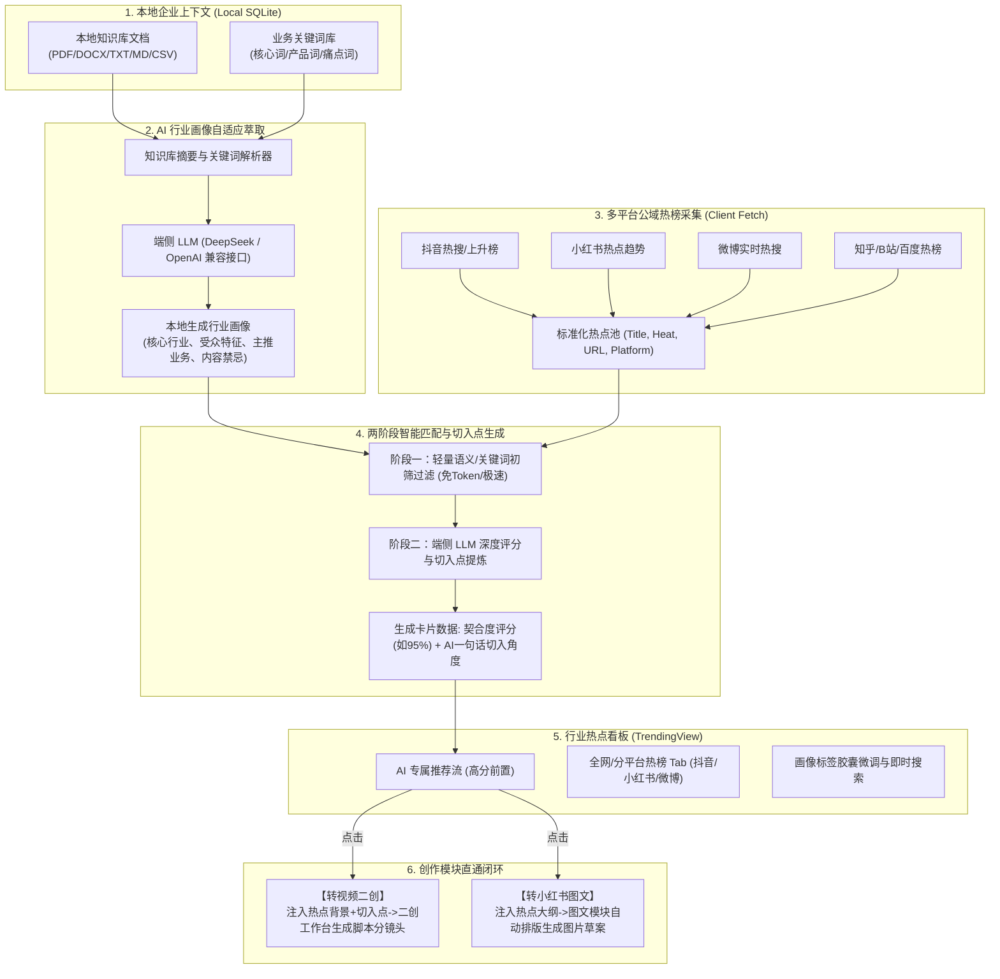
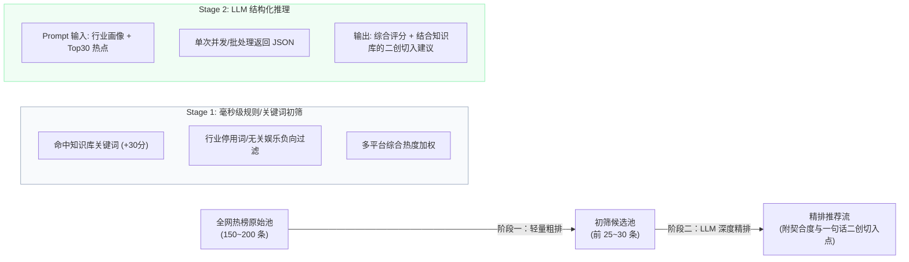

# 《视频二创 AI 助手》行业热点模块设计方案

> **设计基准**：基于 `/grill-me` 深度访谈确认的决策分支，遵循现有客户端自治直连架构、本地 SQLite 存储、多大模型接入及双工作台（视频二创 / 小红书图文）业务流。

---

## 一、 模块概述与核心价值

### 1.1 业务背景与痛点
在当前企业新媒体运营实践中，内容创作者每天面临以下瓶颈：
- **无效信息过载**：全网热搜（抖音、小红书、微博、知乎等）多为娱乐八卦或社会新闻，特定行业（如大健康、数码、美妆、财税、母婴）难以迅速找到与自身品类匹配的素材。
- **弱相关难借势**：即便看到热门话题，创作者往往需要耗费大量时间思考“这个热点和我们公司的产品/服务有什么关系、如何切入才自然不生硬”。
- **流程割裂**：在浏览器或手机找热点、在文档写大纲、再复制进工具二创，跨环节损耗严重。

### 1.2 模块核心定位
新增的**「行业热点」模块**定位为**“智能化选题引擎”**：
1. **零门槛自适应**：自动扫描分析用户在本地导入的知识库文档与业务关键词，自动萃取精准的行业画像，无需复杂手动配置。
2. **多平台热榜聚合与三维匹配**：聚合抖音、小红书、微博、知乎、快手等平台实时榜单，通过轻量级算法与端侧大模型，为每个热点计算**【行业相关度 + 爆款热度 + 二创可行性】**三维综合评分。
3. **AI 一句话二创切入点**：为高契合度热点直接生成结合本地企业业务特性的二创切入角度与文案选题。
4. **一键双模直通生成**：卡片直接提供【转视频二创】与【转小红书图文】，秒级流转至工作台自动开启创作闭环。

---

## 二、 系统架构与全流程数据流

严格沿用当前客户端架构：**远程授权服务器仅做身份鉴权与审计，业务全流程由客户端直连完成，零数据泄露风险**。

### 2.1 架构时序与数据流图



---

## 三、 详细功能设计

### 3.1 行业画像自适应引擎 (AI Industry Profiler)

#### 3.1.1 触发与构建机制
- **静默推算**：在用户进入“行业热点”模块时，若本地尚无行业画像缓存，系统自动读取 SQLite 中已启用的知识库文本片段（`knowledge_docs`）及业务关键词（`keywords`）。
- **生成内容结构**：
  ```typescript
  export interface IndustryProfile {
    primaryIndustry: string;       // 一级行业，如："大健康 / 滋补养生"
    subCategories: string[];       // 细分二级领域，如：["枸杞原浆", "熬夜护肝", "药食同源"]
    targetAudience: string;        // 目标受众特征，如："25-45岁关注亚健康改善的职场人群"
    corePainPoints: string[];      // 核心业务痛点/卖点，如：["加班疲惫", "睡眠质量差", "无添加纯天然"]
    suggestedAngles: string[];     // 推荐借势切入风格，如：["反常识科普", "打工人共情", "成分辟谣"]
    lastUpdated: number;           // 时间戳
    isManualModified?: boolean;    // 是否被用户手动微调过
  }
  ```
- **冷启动与容错**：
  - 若用户是全新安装且尚未上传任何知识库或关键词，界面呈现友好的**「选择您的行业」快速指引卡片**（内置美妆、数码、母婴、家居、美食、大健康、知识职场等常用行业模板），用户点击即可生成初始画像。

---

### 3.2 热榜采集与规范化管道 (Hotspot Aggregator)

#### 3.2.1 覆盖平台与标准化模型
系统内置对主流新媒体平台的轻量级公开接口适配器：
1. **抖音**：实时热点榜、上升榜、挑战榜；
2. **小红书**：官方热搜词、热点话题榜；
3. **微博**：实时要闻与热搜榜单；
4. **知乎/百度**：全网热议与搜索指数榜。

数据结构统一标准化：
```typescript
export interface HotspotItem {
  id: string;                     // 唯一ID（平台_哈希）
  platform: 'douyin' | 'xiaohongshu' | 'weibo' | 'zhihu' | 'baidu';
  rank: number;                   // 平台原始排名
  title: string;                  // 热点标题/话题名
  heatScore: number | string;     // 原始热度值 (如 "124.5万")
  url: string;                    // 原帖/话题落地页 URL
  categoryTag?: string;           // 平台给出的分类标签 (如 "新", "热", "爆")
  fetchedAt: number;              // 获取时间

  // 以下为 AI 计算填充字段
  relevanceScore?: number;        // AI 匹配综合契合度 (0 - 100)
  remixAngle?: string;            // AI 一句话二创切入点
  isHighMatch?: boolean;          // 是否为强相关 (> 75%)
}
```

#### 3.2.2 缓存与防抖机制
- **本地 TTL 缓存**：热点数据写入端侧内存与临时 SQLite 缓存，默认有效期为 **20 分钟**。在有效期内切换页面无需重复发起网络请求。
- **手动即时刷新**：顶部提供「刷新热榜」按钮，支持强制刷新并显示“更新于 X 分钟前”。

---

### 3.3 两阶段智能匹配机制（性能与成本平衡）

为防止几百条热榜直接发送给 LLM 导致响应过慢及消耗过多 Token，采用经典的高效**两阶段打分模型**：



#### 3.3.1 提示词设计（LLM 阶段二精排）
```text
【角色】你是一名资深新媒体选题总监。
【目标】结合当前公司的企业知识画像，从以下热点话题中筛选适合二创的内容，并给出犀利的切入角度。

【企业画像】：
- 行业：{primaryIndustry}
- 细分业务：{subCategories}
- 核心受众：{targetAudience}
- 核心产品/卖点：{corePainPoints}

【待评热点列表】：
[
  { "id": "dy_1", "title": "热点标题1", "platform": "douyin" },
  ...
]

【输出要求】：
返回 JSON 数组，按推荐程度排序。每个条目包含：
- id: 热点ID
- relevanceScore: 匹配综合得分（0-100，考虑契合度与受众重叠度）
- remixAngle: 结合本企业知识库的【一句话二创切入角度】（20~50字，讲清楚如何巧妙转接到企业话题）
```

---

### 3.4 交互界面设计 (UI / UX Layout)

整体布局保持与系统现有风格统一（Tailwind CSS + Base UI / Radix UI + Motion，深色/浅色自适应）：

```
+----------------------------------------------------------------------------------------------------+
| 侧边栏   |  🔥 行业热点                                       [🔄 刷新数据]  [⚙️ 微调行业画像]       |
|---------+------------------------------------------------------------------------------------------|
| 视频二创 |  [当前行业画像]:  [大健康 / 滋补养生 x] [枸杞原浆 x] [打工人亚健康 x]  [+ 添加细分词]       |
| 小红书   |  --------------------------------------------------------------------------------------- |
| 图文    |  平台筛选: [⭐ AI 专属推荐]  [全部]  [🎵 抖音]  [📕 小红书]  [👁️ 微博]  [❓ 知乎]              |
| 行业热点 |  🔍 搜索全网热点关键词...                                                                 |
| 历史记录 |  --------------------------------------------------------------------------------------- |
| 设置     |  +-------------------------------------------------------------------------------------+ |
|         |  | 98% 强契合  | 🎵 抖音上升榜 #1  |  热度: 289.4万                                      | |
|         |  | 话题：年轻人开始流行“朋克养生”：一边熬夜一边泡脚                                         | |
|         |  | ----------------------------------------------------------------------------------- | |
|         |  | 💡 AI 二创切入点：结合知识库《原浆吸收机制》，从“假装养生”的反转剧情切入，科普温水冲服与  | |
|         |  |                熬夜后微量元素补给的科学依据，强化产品无蔗糖卖点。                   | |
|         |  | ----------------------------------------------------------------------------------- | |
|         |  | [🔗 查看原帖]                       [🎬 转视频二创 (生成脚本)]  [📑 转小红书图文]      | |
|         |  +-------------------------------------------------------------------------------------+ |
|         |  | 91% 高契合  | 📕 小红书热点 #4  |  热度: 156.0万                                      | |
|         |  | 话题：打工人通勤包里不可或缺的3件回血好物                                                | |
|         |  | ----------------------------------------------------------------------------------- | |
|         |  | 💡 AI 二创切入点：以小红书沉浸式翻包图文为形式，借势将便携装原浆作为第 3 件神器出镜，并   | |
|         |  |                搭配提神护眼文案大纲。                                               | |
|         |  | ----------------------------------------------------------------------------------- | |
|         |  | [🔗 查看原帖]                       [🎬 转视频二创 (生成脚本)]  [📑 转小红书图文]      | |
|         |  +-------------------------------------------------------------------------------------+ |
+----------------------------------------------------------------------------------------------------+
```

---

### 3.5 下游双工作台无缝流转规范

#### 3.5.1 点击【转视频二创】
1. **状态传递**：通过 `useAppStore` 传递预置上下文：
   - `inputUrl`：若热点带有可用原帖视频链接，则自动填入原帖链接；若为纯热搜话题，则置空。
   - `topicPrompt`：将“热点标题 + AI 切入角度 + 关联知识库要点”注入为预置二创主题。
2. **自动跳转**：调用 `setActiveNav('workbench')`。
3. **工作台响应**：在二创工作台直接显示热点背景条，并自动激活“生成视频脚本”流式请求，无需用户重新打字。

#### 3.5.2 点击【转小红书图文】
1. **状态传递**：通过 `useImageTextStore` 传递图文草案元数据：
   - `title`：结合热点切入点自动生成爆款小红书标题候选。
   - `concept`：注入由热点衍生的分页面策划大纲。
   - `style`：沿用用户设定的默认生图风格与比例（如 3:4）。
2. **自动跳转**：调用 `setActiveNav('image-text')`。
3. **工作台响应**：直接进入图文策划确认界面，用户可一键确认张数、风格并启动整套高质量 AI 生图。

---

## 四、 工程实现路线与代码改动清单

| 模块 / 文件 | 改动性质 | 具体职责 |
| :--- | :--- | :--- |
| `src/types/trending.ts` | **新建** | 定义 `HotspotItem`, `IndustryProfile`, `PlatformType` 等 TypeScript 接口类型 |
| `src/store/useTrendingStore.ts` | **新建** | 管理当前热点列表、过滤条件、画像缓存、AI 打分状态与加载状态的 Zustand Store |
| `src/services/trendingService.ts` | **新建** | 负责全网各平台公开热搜的数据抓取、标准化处理与 TTL 缓存维护 |
| `src/services/aiTrendingAnalyzer.ts`| **新建** | 结合已配置的 DeepSeek/OpenAI 模型，实现画像提取、热点两阶段智能打分与切入点生成 |
| `src/components/Sidebar.tsx` | **修改** | 在主导航菜单中增加 `行业热点`（图标采用 `Flame` 或 `TrendingUp`） |
| `src/views/TrendingView.tsx` | **新建** | 行业热点主视图（包含画像胶囊栏、平台筛选器、搜索栏及热点卡片流） |
| `src/components/trending/` | **新建** | 包含 `HotspotCard.tsx`, `ProfileSettingsModal.tsx`, `PlatformTabs.tsx` 等细分子组件 |
| `src/App.tsx` | **修改** | 在导航路由分支中挂载 `{activeNav === 'trending' && <TrendingView />}` |

---

## 五、 异常边界与鲁棒性保障

1. **部分平台反爬与请求超时**：
   - 抓取层采用独立 Promise 并发请求（`Promise.allSettled`），单个平台失败不阻断其他平台数据的展示，卡片上注明可用数据源。
2. **知识库文档较大时的性能控制**：
   - 提取画像时仅抽取知识库前 2000 字代表性文本与标题，结合用户配置的业务关键词生成轻量画像，杜绝超时。
3. **大模型未配置或额度耗尽**：
   - 若用户尚未配置大模型 API Key，系统优雅降级为“平台原始热搜榜 + 关键词高亮匹配”，并在顶部提醒用户配置 API Key 以解锁“AI 契合度评分与二创切入点”。
4. **历史记录追踪**：
   - 从热点模块发起的视频与图文在保存到 SQLite 历史记录时，标注 `sourceHotspot` 溯源字段，方便后续统计“热点二创”成片率与效果。
